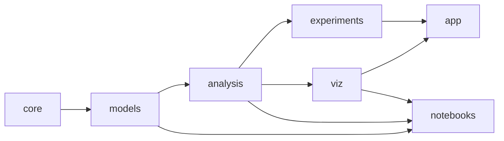

# Architecture

Version 00 plan. How the laboratory will be built, and why. Nothing here is
implemented yet; the first code arrives with version 01. Decisions that
depend on measurements (frame rates, kernel speeds) are marked as gates to be
checked during 01.

## 1. What the design has to achieve

The brief translates into six requirements:

1. **Correctness that can be checked.** Every model is treated as a
   scientific claim: a written specification, a reference implementation, and
   tests against exact results.
2. **Reproducibility.** Every number the lab reports can be regenerated from
   a versioned configuration, a seed and a code version.
3. **One implementation, two front ends.** The same model code serves the
   interactive app and the research notebooks; nothing is duplicated.
4. **Live, inspectable visualization.** Play, pause, step, reset and speed
   controls; the state of a cell or node can be inspected; macroscopic plots
   update with the microscopic view.
5. **Modest hardware.** It must run comfortably on an ordinary laptop with
   8 GB of memory and no dedicated GPU.
6. **Few dependencies, added only when justified.**

## 2. Options considered for the interactive layer

The model code is plain Python with NumPy in every option. The choice is
about the interface.

| Option | Live animation | Controls and layout | Mathematics | Reuse in notebooks | Main risk |
|---|---|---|---|---|---|
| **Streamlit** | Adequate: `st.fragment(run_every=...)` reruns only the animated part on a timer | Very easy | KaTeX in `st.markdown` and `st.latex` | Same package, separate thin UI | The rerun model needs disciplined use of session state |
| Panel (HoloViz) | Good: periodic callbacks and Bokeh streaming | Flexible | KaTeX or MathJax | Excellent: the same objects in a notebook and a server | Steeper learning curve, heavier dependency stack |
| Jupyter + ipywidgets | Moderate | Basic | MathJax | Native | Hidden notebook state hurts reproducibility |
| marimo | Moderate (refresh timers, anywidget) | Good | KaTeX | The notebook *is* the app; reactive, stored as plain `.py` | Younger ecosystem; custom widgets for fast lattice views |
| Dash | Moderate (interval callbacks) | Flexible but verbose | MathJax | Separate | Callback boilerplate |
| Desktop Qt (PySide6 + pyqtgraph) | Excellent | Full control | Weak without a web view | Poor | Much more UI code; heavy |
| Web front end (TypeScript, WebGL) + Python back end | Excellent | Full control | KaTeX | Separate | Two languages; temptation to re-implement models in JavaScript |

### Recommendation

- **Streamlit** for the app;
- **Jupyter** notebooks for research;
- a small **command-line runner** for long experiments and parameter sweeps.

All three import the same package. The app layer is kept thin, so moving to
Panel or marimo later would touch only `app/`.

Streamlit is the simplest option that meets the requirements. Live animation
is its weak point; the fragment mechanism exists for exactly this case.

**Gate 1, measured in version 01.** A $128\times128$ sandpile with a live
image and two live plots must reach at least 10 frames per second on an
ordinary laptop, with several simulation steps per frame. If it does not,
the app moves to Panel before more pages are written.

**Plotting.**

- *Matplotlib*: figures for notebooks, reports and exported files, produced
  by shared figure-building functions.
- *Fast RGB images*: lattice states in the live view, built directly from
  arrays.
- *Streamlit's built-in charts*: live time series.
- *Plotly* (optional): hover inspection of small lattices and graphs, added
  only if the plain cell inspector is not enough.

## 3. Technology stack

| Purpose | Choice | Note |
|---|---|---|
| Language | Python ≥ 3.12 | Current NumPy (2.5) and SciPy (1.18) releases require 3.12 or newer (checked on PyPI, 2026-10-13) |
| Arrays | NumPy | `numpy.random.Generator` with PCG64; `SeedSequence.spawn` for independent streams |
| Scientific routines | SciPy | Elliptic integrals (Onsager), root finding (self-consistency equations), ODE solvers for cross-checks, statistical distributions |
| Compiled kernels | Numba, **only after profiling** | Sandpile relaxation and single-spin Monte Carlo are sequential loops that NumPy cannot vectorize; Numba 0.68 has wheels for Python 3.10–3.15 |
| Plots | Matplotlib | One set of figure functions for all front ends |
| App | Streamlit | Optional extra `[app]` |
| Notebooks | JupyterLab | Optional extra `[notebooks]` |
| Tests | pytest, Hypothesis | Property-based tests for invariants |
| Configuration | TOML read with the standard library (`tomllib`) | Human-written, versioned |
| Results | CSV and JSON; NPZ for arrays | Every file has a JSON metadata sidecar |
| Graphs (later) | NetworkX | Only with the network modules |
| Lint (development) | ruff | Not a runtime dependency |

## 4. Package layout

```text
complexsystemslab/
├── complexsystemslab/
│   ├── core/            # no UI, no file I/O
│   │   ├── rng.py       # seed policy: root seed → SeedSequence → spawned generators
│   │   ├── params.py    # frozen, validated parameter dataclasses (units, ranges)
│   │   ├── protocols.py # the Model protocol
│   │   └── lattice.py   # neighbour tables, boundary conditions, sinks
│   ├── models/
│   │   ├── sandpile/    # model.py, relax.py, theory.py, branching.py, observables.py
│   │   ├── ising/       # model.py, dynamics.py, exact.py, meanfield.py, observables.py, rg.py
│   │   └── kuramoto/    # model.py, integrate.py, theory.py, observables.py
│   ├── analysis/
│   │   ├── stats.py         # online moments, bootstrap, jackknife, confidence intervals
│   │   ├── timeseries.py    # autocorrelation, integrated autocorrelation time, blocking
│   │   ├── distributions.py # log-binning, CCDF, discrete power-law MLE, KS tests, likelihood ratios
│   │   ├── scaling.py       # data collapse, moment analysis, Binder crossings
│   │   └── spatial.py       # correlation functions by FFT, cluster labelling
│   ├── experiments/
│   │   ├── config.py    # TOML → validated configuration objects
│   │   ├── runner.py    # replicas, sweeps, checkpoints, progress
│   │   ├── records.py   # run metadata: versions, git commit, seeds, platform
│   │   └── export.py    # CSV, JSON, NPZ
│   ├── viz/
│   │   ├── images.py    # arrays → RGB images for the live view
│   │   └── figures.py   # Matplotlib figure builders
│   ├── app/             # Streamlit only
│   ├── validate.py      # python -m complexsystemslab.validate <model>
│   └── cli.py           # python -m complexsystemslab run <config.toml>
├── docs/
│   ├── research/        # version 00 research notes
│   ├── plan/            # this file and the roadmap
│   ├── specs/           # the specification template
│   └── models/          # one 14-part specification per model (from 01)
├── experiments/
│   ├── configs/         # versioned TOML configurations
│   └── results/         # outputs, ignored by git except curated references
├── notebooks/
├── scripts/             # maintenance scripts (reference and number checks)
└── tests/
```

The package sits at the repository root (a flat layout). Dependencies point
one way only:



An arrow from A to B means B may import A, never the reverse. The app and the
notebooks are clients; nothing in the package imports them.

## 5. The model interface

Every model implements the same small protocol, so the runner, the app and
the notebooks can drive any of them:

```python
class Model(Protocol):
    params: Params        # frozen dataclass, validated on construction
    t: float              # time, in the unit documented in the model's spec

    def step(self, n: int = 1) -> None: ...
    def observables(self) -> dict[str, float]: ...
    def snapshot(self) -> dict: ...  # everything needed to resume exactly, RNG state included

    @classmethod
    def from_snapshot(cls, snapshot: dict) -> "Model": ...
```

What counts as one step is part of each model's specification:

| Model | One step | Finer resolution for the live view |
|---|---|---|
| Sandpile | Add one grain and relax completely (the slow-driving limit) | A generator that yields after each synchronous toppling sweep, so an avalanche can be watched |
| Ising | One Monte Carlo sweep: $N$ attempted single-spin updates | A partial sweep (checkerboard half-sweep) |
| Ising, Wolff | One cluster flip, converted to sweeps by the mean cluster size | — |
| Kuramoto | Advance time by the integration step $\Delta t$ | Observables sampled every $\Delta t_{\mathrm{obs}}$ |

## 6. Reproducibility

- **Seeds.** Every stochastic run has a root seed. Replicas get independent
  streams from `numpy.random.SeedSequence(root).spawn(n)`; the spawn key is
  recorded. No global random state is used anywhere.
- **Metadata.** Every result file is accompanied by a JSON record:
  - package version, git commit and whether the working tree was clean;
  - Python, NumPy, SciPy and Numba versions; platform;
  - the full configuration and the seeds;
  - start and end times; which kernel ran (reference or compiled).
- **Configurations** live in `experiments/configs/` and are versioned.
  Results are regenerated, not edited.
- **What "reproducible" means.**
  - *Bitwise* reproducibility is guaranteed only on the same platform with
    the same library versions; compiled and NumPy kernels may differ in the
    last bits of floating-point results (the Numba documentation says so).
  - *Statistical* reproducibility, the same conclusions within error bars on
    any platform, is the scientific requirement. The tests check exactly
    that.
- **Numba and random numbers.** Numba's legacy `np.random` functions keep
  their own state, separate from NumPy's, and NumPy `Generator` objects
  passed into compiled functions are not thread-safe. Compiled kernels
  therefore receive a `Generator` explicitly and run single-threaded, or
  receive pre-drawn random numbers. Which of the two is documented per
  kernel.

## 7. Numerical correctness

- **Reference first.** Each model has a slow, readable reference
  implementation that serves as the executable form of its specification.
  A compiled kernel is accepted only if it passes equivalence tests against
  the reference:
  - identical results for deterministic rules;
  - identical results with the same random numbers where possible;
  - statistically indistinguishable distributions otherwise.
- **Precision.** `float64` throughout; integer types for discrete states,
  with overflow checks during relaxation.
- **Documented order.** Update order and the order in which random numbers
  are consumed are part of the specification, because they change
  trajectories and sometimes statistics (avalanche durations).
- **Stability.** Time steps for differential equations are justified by a
  stability bound or by a convergence test (halving $\Delta t$).

## 8. Testing strategy

| Layer | What it checks | Example |
|---|---|---|
| Unit | One rule at a time | A site with four grains topples to zero and feeds four neighbours |
| Invariants (property-based) | Laws that hold for every input | Grain conservation: grains added = grains in the system + grains lost to the sink; the Abelian property on random configurations and random toppling orders; detailed balance of the Metropolis kernel |
| Exact comparison | Small systems with known answers | $\det\Delta$ recurrent configurations on the $3\times3$ grid; exact enumeration of the $4\times4$ Ising torus; Ott–Antonsen dynamics for Lorentzian frequencies |
| Statistical | Simulation against theory with pre-set tolerances and fixed seeds | Height probabilities in the bulk; Binder crossing near $U^{\ast}\approx0.6107$; Borel distribution of branching-process progeny |
| Regression | Results do not change silently | Small golden result files, regenerated only on purpose |
| Validation report | The scientific check, generated on demand | `python -m complexsystemslab.validate sandpile` writes figures and a table comparing simulation and theory |

Statistical tests use fixed seeds and tolerances set from the expected
standard error, so that they are deterministic and still meaningful.

## 9. Performance

- **Measure before optimizing.** NumPy first, then a profile, then Numba for
  the hot loops that need it.
- **Expected hot spots.** Sandpile relaxation (cost proportional to the
  avalanche size; the mean size grows like $L^2$) and single-spin Monte Carlo
  near $T_c$.
- **Memory.** No stored histories of full configurations. Statistics are
  accumulated online (running moments, histograms); snapshots are taken at
  chosen times only.
- **Gate 2, measured in 01.** If the NumPy implementation of the sandpile
  cannot produce $10^6$ avalanches on a $128\times128$ lattice within
  minutes, a compiled kernel is added, with its equivalence tests.

## 10. The app

One page per model, each with the same five tabs:

1. **Live.** The microscopic state as an image; play, pause, step, reset;
   speed (steps per frame); parameter controls with their definitions;
   initial and boundary conditions; live plots of macroscopic observables; a
   cell or node inspector that shows the local state and its neighbourhood.
2. **Mathematics.** The model's specification rendered from
   `docs/models/<model>.md`. The documents are written for GitHub
   (display equations in fenced `math` blocks); the app converts those blocks
   to the `$$…$$` form that Streamlit renders, so there is one source.
3. **Methods.** The algorithm in pseudocode, update order, random-number use,
   and known numerical pitfalls.
4. **Experiment.** A form for replicas, sweeps and sizes. The hypothesis and
   prediction must be written before a run starts and are stored with the
   results. Long experiments are handed to the command-line runner.
5. **Results.** Estimates with confidence intervals, comparisons with theory,
   export to CSV and JSON.

Side-by-side comparisons (two parameter sets, two seeds, two boundary
conditions) reuse the Live tab with two model instances.

## 11. Risks and mitigations

| Risk | Mitigation |
|---|---|
| Streamlit cannot animate fast enough | Gate 1; fall back to Panel, keeping all non-UI code |
| Statistical tests are flaky | Fixed seeds; tolerances from computed standard errors; few, decisive tests |
| A compiled kernel silently disagrees with the specification | Equivalence tests against the reference implementation |
| Claims drift beyond the evidence | Evidence labels in specifications and results; the experiment protocol of the [experiments notes](../research/05-experiments-and-open-questions.md#1-how-an-experiment-is-run-in-this-lab) |
| Memory pressure on an 8 GB laptop | Online statistics; no stored histories; lattice sizes chosen with a memory estimate |
| Scope creep | A model enters only after its specification and validation criteria are written ([roadmap](roadmap.md)) |

## 12. Workflow and versions

- **Version numbers.** Each version (00, 01, 02, …) is developed on a branch
  and merged through a pull request. It gets a tag `vNN`, a GitHub release
  "NN" and an entry in `UPDATE_LOG.md`; the README is rewritten for it.
- **Specification first.** A module's specification is committed before its
  code.
- **Language.** Everything in the repository is in English and independent
  of the operating system; the setup instructions cover Windows, macOS and
  Linux.
