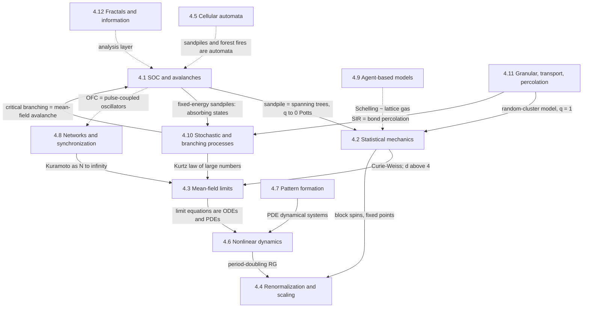

# 01 · A map of the field

Version 00 research notes. This document lays out the conceptual structure of
the subject: the questions, the mechanisms that link microscopic rules to
macroscopic behaviour, the twelve families of models the lab draws on, and
which connections between them are theorems, which are approximations, and
which are only analogies. Models are described in detail in the
[model catalogue](02-model-catalogue.md). References are given by author and
year; full entries with DOIs are in the [bibliography](04-bibliography.md).

## Evidence labels

Every non-trivial claim in these notes carries one of the following labels.
They are used the same way in the model specifications that come later.

| Label | Meaning |
|---|---|
| **[proven]** | A mathematical proof exists; the proof is cited. |
| **[exact]** | Obtained by an exact calculation that is standard in physics but not fully rigorous (for example conformal field theory, Coulomb gas or some Bethe-ansatz arguments). |
| **[approx]** | Follows from an approximation whose assumptions are stated (mean-field closure, pair approximation, truncated expansion). |
| **[numerical]** | Supported by simulations or numerics. Its reliability depends on system sizes, fitting procedures and conventions, which are cited. |
| **[conjecture]** | Explicitly conjectured in the literature. |
| **[heuristic]** | A plausibility argument or physical picture, not a derivation. |
| **[contested]** | Published work disagrees; both sides are cited. |

## 1. The organising question

How do many interacting components produce simple, often universal,
macroscopic behaviour? The common setting is:

- a finite set of sites, agents or oscillators $\Lambda$, usually a lattice
  $\lbrace 1,\dots,L\rbrace^d$ or a graph with $N = \lvert \Lambda \rvert$
  vertices;
- a local state space $S$, so a configuration is an element of
  $\Omega = S^\Lambda$;
- a microscopic dynamics: a deterministic map $T:\Omega\to\Omega$ (a cellular
  automaton), a Markov chain with transition probabilities
  $P(\sigma\to\sigma')$, or a differential equation on a continuous state
  space (for example phases on the torus $\mathbb{T}^N$);
- a handful of macroscopic observables $M_N(\sigma)$: a magnetization, a
  density, an order parameter such as $r e^{i\psi}$, avalanche sizes, and
  their distributions and correlations in space and time.

The interesting statements are almost always about limits: $N\to\infty$
(thermodynamic limit), $t\to\infty$ (stationary states), or both in a
prescribed order. Finite systems have analytic partition functions and
finite-state Markov chains have unique stationary distributions under mild
conditions, so phase transitions, broken ergodicity and true power laws are
properties of limits. A simulation always sees finite-size versions of them.
Making the extrapolation explicit (finite-size scaling, convergence checks) is
part of every experiment in this lab.

"Emergence" is used here in the weak sense of Bedau (1997): a property of the
macroscopic observables, usually in a limit, that is not a property of the
components and that in principle follows from the microscopic rule, though in
practice often only by simulation. Anderson's "More is different" (1972) gives
the physicist's version. All phenomena in this lab come from explicit rules,
so the lab takes no position on "strong" emergence.

## 2. Four mechanisms that connect micro and macro

Almost every model in the lab is an instance of one or more of these.

1. **Laws of large numbers and mean-field limits.** When each component
   interacts weakly with many others, or the population is well mixed,
   fluctuations average out and a deterministic equation for macroscopic
   densities appears. Rigorous versions exist:
   - density-dependent Markov chains converge to the solution of an ODE on
     finite time intervals **[proven: Kurtz 1970, 1971]**;
   - mean-field particle systems show propagation of chaos and converge to
     McKean–Vlasov equations **[proven: Sznitman 1991]**;
   - the Kuramoto model has a Vlasov limit on finite time intervals
     **[proven: Lancellotti 2005]**.

   The limits $N\to\infty$ and $t\to\infty$ generally do not commute.
   Extinction in a finite stochastic epidemic, for example, is certain, while
   the mean-field ODE can have a stable endemic state.
2. **Phase transitions and criticality.** In the thermodynamic limit the free
   energy can be non-analytic. Spontaneous symmetry breaking produces an order
   parameter. At a critical point the correlation length diverges and
   observables become scale invariant. Universality, the independence of
   critical exponents from microscopic details, is explained by the
   renormalization group (Wilson 1971; Fisher 1998). The explanation is
   **[heuristic]** in general and **[proven]** in special cases.
3. **Instabilities of homogeneous states.** A uniform state can lose stability
   to a stationary spatial pattern (Turing 1952), to oscillations (a Hopf
   bifurcation), or to collective synchronization (Kuramoto 1975). Near
   threshold, amplitude equations describe the emerging structure
   **[approx, controlled near threshold: Cross & Hohenberg 1993]**.
4. **Slow driving and threshold relaxation.** Systems loaded slowly that relax
   in fast avalanches can organize themselves into a state where avalanches of
   all sizes occur (Bak, Tang & Wiesenfeld 1987, 1988). The modern reading is
   that the driven, dissipative system sits at the critical point of an
   underlying absorbing-state transition, and that the "tuning" is done by the
   separation of time scales: driving and dissipation rates go to zero
   **[heuristic and numerical: Dickman et al. 2000; Vespignani et al. 2000;
   Pruessner 2012]**. The precise statement is subtle: Fey, Levine & Wilson
   (2010) showed that the stationary density of the driven sandpile and the
   threshold density of its fixed-energy counterpart can differ.

## 3. Core concepts, defined precisely

### Order parameters and phase transitions

For the Ising model on a finite box $\Lambda\subset\mathbb{Z}^d$ with
configurations $\sigma\in\lbrace -1,+1\rbrace^\Lambda$:

```math
H_\Lambda(\sigma) = -J\sum_{\langle i,j\rangle}\sigma_i\sigma_j - h\sum_{i\in\Lambda}\sigma_i,\qquad
\mu_{\Lambda,\beta,h}(\sigma) = \frac{e^{-\beta H_\Lambda(\sigma)}}{Z_\Lambda(\beta,h)} .
```

The free energy density

```math
f(\beta,h) = -\lim_{\Lambda\uparrow\mathbb{Z}^d}\frac{1}{\beta\lvert\Lambda\rvert}\log Z_\Lambda(\beta,h)
```

exists, and $-\beta f$ is convex in $h$. The spontaneous magnetization is

```math
m^{\ast}(\beta) = \lim_{h\downarrow 0}\ \lim_{\Lambda\uparrow\mathbb{Z}^d}\langle\sigma_0\rangle_{\Lambda,\beta,h},
```

and the order of the limits matters. In
$d\ge 2$ there is a $\beta_c\in(0,\infty)$ with $m^{\ast}=0$ for $\beta<\beta_c$
and $m^{\ast}>0$ for $\beta>\beta_c$ **[proven: Peierls 1936 and Griffiths 1964
give order at low temperature; see Friedli & Velenik 2017 for the complete
statement]**; in
$d=2$ the value and the curve $m^{\ast}(\beta)$ are known exactly **[proven: Onsager
1944; Yang 1952]**. In $d=1$ there is no transition at positive temperature
**[proven: Ising 1925]**.

### Criticality, exponents and scaling

With $t = (T-T_c)/T_c$ and the connected correlation function
$G(r) = \langle\sigma_0\sigma_r\rangle - \langle\sigma_0\rangle\langle\sigma_r\rangle$:

```math
G(r) \sim e^{-r/\xi}\ (t\neq 0),\qquad G(r)\sim r^{-(d-2+\eta)}\ (t=0),\qquad
\xi\sim\lvert t\rvert^{-\nu},\quad m^{\ast}\sim(-t)^{\beta},\quad \chi\sim\lvert t\rvert^{-\gamma},\quad C\sim\lvert t\rvert^{-\alpha}.
```

(Here $\beta$ denotes both the inverse temperature and an exponent; the
context always decides.) The exponents obey scaling relations such as
$\alpha+2\beta+\gamma=2$ and $\gamma=\nu(2-\eta)$; the hyperscaling relation
$2-\alpha=d\nu$ holds below the upper critical dimension and fails above it.
These follow from the scaling hypothesis **[heuristic, justified by the RG]**;
some inequalities between exponents, such as Rushbrooke's
$\alpha+2\beta+\gamma\ge2$, follow rigorously from thermodynamic stability
(see Goldenfeld 1992).

**Finite-size scaling.** Near criticality, an observable $O$ on a system of
linear size $L$ behaves as

```math
O_L(t) \simeq L^{x_O/\nu}\,\mathcal{F}_O\!\left(t\,L^{1/\nu}\right),
```

where $x_O$ is the exponent of $O$ in the infinite system and
$\mathcal{F}_O$ is a scaling function. This is how critical points and
exponents are extracted from simulations (Binder 1981; Landau & Binder 2021).
It is a hypothesis **[heuristic, numerically well supported]** and it can fail.
The two-dimensional BTW sandpile is the standard counterexample (Section 4).

### Universality

Universality classes are labelled by dimension, symmetry of the order
parameter, range of interactions and conservation laws. Universal quantities
are exponents, amplitude ratios and scaling functions. Non-universal ones are
the location of critical points ($T_c$, $p_c$, $K_c$). Comparing a model with
an experiment or with another model is meaningful only for universal
quantities and only within a class.

### Mean-field theory means four different things

1. A **self-consistent single-site approximation**: replace the neighbours of
   a site by their average, as in $m=\tanh(\beta(zJm+h))$ for the Ising model
   with $z$ neighbours **[approx]**.
2. The **exact solution of a model with all-to-all interactions**, such as the
   Curie–Weiss model, where the self-consistency equation is a theorem
   **[proven: e.g. Ellis 1985]**.
3. The **$N\to\infty$ limit equation** of a large interacting system: an ODE
   for densities (Kurtz), a Vlasov or McKean–Vlasov PDE for a distribution of
   states (Sznitman), the Ott–Antonsen equations for Kuramoto oscillators
   **[proven, under the stated assumptions]**.
4. **Landau theory**: an expansion of a free energy in the order parameter
   near a transition **[approx]**.

Mean-field critical exponents ($\beta=1/2$, $\gamma=1$, $\delta=3$, $\nu=1/2$,
$\eta=0$ for Ising-like systems) are exact above an upper critical dimension
$d_c$. For the Ising model $d_c=4$: mean-field behaviour for $d>4$ is
**[proven: Aizenman 1982]** and the marginal case $d=4$ is **[proven: Aizenman
& Duminil-Copin 2021]**. For percolation $d_c=6$. For directed percolation $d_c=4$ (field theory,
Hinrichsen 2000); for the Manna and BTW sandpiles the usual value is also
$d_c=4$ **[heuristic and numerical]**.

### Absorbing states

A configuration is absorbing if the dynamics cannot leave it, for example the
all-healthy state of an epidemic or a stable sandpile without drive.
Transitions into absorbing states are intrinsically out of equilibrium:
detailed balance fails because the absorbing state cannot be left. The
directed-percolation conjecture states that, with a single absorbing state, a
scalar order parameter, short-range interactions and no extra symmetry or
conservation law, the transition is in the directed-percolation (DP) class
**[conjecture: Janssen 1981; Grassberger 1982; strongly supported numerically
and experimentally: Hinrichsen 2000; Takeuchi et al. 2007]**. Sandpiles have
a conserved field (the grain density), which changes the class to the
"Manna" or conserved-DP class **[numerical]**. In one dimension whether that
class really differs from DP is **[contested]** (Basu et al. 2012; Lee 2014).

### Self-organized criticality (SOC)

Bak, Tang & Wiesenfeld (1988) argued that "dynamical systems with extended
spatial degrees of freedom in two or three dimensions naturally evolve into
self-organized critical states". By "self-organized" they meant that the
state is reached "without detailed specification of the initial conditions
(i.e., the critical state is an attractor of the dynamics)", and they stressed
that it is "robust with respect to variations of parameters, and the presence
of quenched randomness". Its signatures were to be power-law spatial
correlations and $1/f$ noise. Later work kept the first part and dropped the
$1/f$ claim (Section 4). A working definition used in this lab, in the spirit
of Pruessner (2012), is:

> A model is self-organized critical if, under slow driving with avalanche
> relaxation and dissipation that vanishes in the thermodynamic limit, its
> stationary state shows finite-size scaling of avalanche observables (sizes,
> durations, areas) with non-trivial exponents, without tuning a parameter
> other than the separation of time scales.

Two points matter for experiments. First, an observed power law is not
evidence of SOC on its own: many mechanisms produce heavy tails (Clauset,
Shalizi & Newman 2009; Stumpf & Porter 2012; Touboul & Destexhe 2017). Second, the separation of time scales *is* a tuning
of two parameters, the driving rate and the dissipation rate, to zero.

### Self-organization without criticality

Turing patterns, synchronization, flocking, segregation and drainage networks
are self-organized: macroscopic order arises from internal interactions
without the pattern being imposed from outside. None of them requires
criticality. "Self-organized" and "self-organized critical" are different
claims.

### Emergent versus imposed

For agent-based models in particular, the lab separates three things:

1. what follows directly from the rule (agents that prefer similar neighbours
   will cluster to some extent);
2. what is collective and non-obvious (the threshold at which mild individual
   preferences produce strong segregation, or the sudden onset of
   synchronization at $K_c$);
3. what is put in through the setup (boundary conditions, initial states,
   the choice of observable).

The tools for separating them are null models, ablation of individual rules,
mean-field predictions that show which features survive without correlations,
and sensitivity checks on boundaries and initial conditions.

## 4. The twelve families

Each family is described by its foundational questions, its mathematical
language, its canonical models, its links to other families, and what it can
and cannot explain.

### 4.1 Self-organized criticality, avalanches and absorbing-state transitions

- **Questions.** Can a slowly driven dissipative system reach a critical state
  without tuning? What determines avalanche exponents? How is SOC related to
  ordinary (absorbing-state) phase transitions?
- **Mathematics.** Markov chains on stable configurations; threshold
  dynamics; graph Laplacians, abelian groups (the sandpile group), spanning
  trees and loop-erased random walks; branching processes; Langevin equations
  with multiplicative noise; the scaling ansatz
  $P(s)\simeq s^{-\tau}\mathcal{G}(s/L^{D})$.
- **Canonical models.** Bak–Tang–Wiesenfeld (BTW) and the Abelian sandpile,
  Manna, Oslo, Olami–Feder–Christensen (OFC), forest fire, Bak–Sneppen,
  fixed-energy sandpiles, contact process.
- **Links.** Absorbing-state transitions (4.10); percolation (4.11); the
  $q\to 0$ Potts model (4.2) via spanning trees; mean-field theory (4.3) via
  branching processes; cellular automata (4.5).
- **Can explain.** Why slow drive, thresholds and dissipation generate
  scale-free avalanches in models; exact statistics of the Abelian sandpile's
  stationary state.
- **Cannot explain, or not by itself.** $1/f$ noise: the flow of sand in the
  BTW model has a $1/f^2$ spectrum, not $1/f$ (Jensen, Christensen & Fogedby
  1989; see Laurson, Alava & Zapperi 2005 for other signals). Nor does a model
  show that a natural power law (earthquakes, neuronal avalanches) is caused
  by SOC.

### 4.2 Equilibrium and non-equilibrium statistical mechanics

- **Questions.** How do thermodynamic properties follow from microscopic
  Hamiltonians? When are there phase transitions? What changes when detailed
  balance fails?
- **Mathematics.** Gibbs measures; infinite-volume limits (DLR conditions);
  convexity; correlation inequalities (Griffiths, FKG); transfer matrices;
  random-cluster (Fortuin–Kasteleyn) representations; Markov chain Monte
  Carlo (MCMC) with detailed balance; large deviations. Out of equilibrium:
  master equations, currents, entropy production.
- **Canonical models.** Ising, Potts, XY, lattice gases; out of equilibrium:
  exclusion processes (TASEP), the contact process, the voter model.
- **Links.** RG (4.4); mean-field theory (4.3); percolation (4.11) as the
  $q\to1$ random-cluster model; MCMC as stochastic processes (4.10).
- **Can explain.** Equilibrium phase diagrams; exact critical behaviour in two
  dimensions; relaxation towards equilibrium.
- **Cannot, by itself.** Driven systems without detailed balance. For example,
  flocks in two dimensions can have true long-range order (Toner & Tu 1995),
  which the Mermin–Wagner theorem (1966) forbids for the equilibrium XY model.

### 4.3 Mean-field theory and kinetic or continuum limits

- **Questions.** When can a many-body problem be replaced by a closed equation
  for a few macroscopic variables? What is lost?
- **Mathematics.** Self-consistency equations; Curie–Weiss and large
  deviations; laws of large numbers for density-dependent jump processes
  (Kurtz); propagation of chaos (Sznitman); moment closures (pair
  approximation, Keeling 1999); the van Kampen system-size expansion; Landau
  theory; the Ginzburg criterion and the upper critical dimension.
- **Canonical models.** Curie–Weiss; SIS and SIR rate equations; logistic
  growth; the Kuramoto model and the Ott–Antonsen reduction; branching
  processes as the mean-field theory of avalanches.
- **Links.** All families. Mean-field theory is exact on complete graphs
  (Curie–Weiss) and the Bethe approximation is exact on the Bethe lattice, an
  infinite regular tree (Bethe 1935); mean-field behaviour also becomes exact
  in high dimensions and in the limit of long-range interactions (Lebowitz &
  Penrose 1966).
- **Can explain.** Existence and qualitative shape of transitions; thresholds
  such as $R_0=1$; mean-field exponents.
- **Cannot explain.** Low-dimensional critical exponents; fluctuation effects
  such as the absence of a transition in the one-dimensional Ising model
  (mean-field theory predicts one); spatial correlations; demographic noise,
  which can sustain cycles that the mean-field ODE says are damped
  (McKane & Newman 2005).

### 4.4 Renormalization group, universality, scaling and finite-size scaling

- **Questions.** Why do microscopically different systems share exponents?
  How do effective interactions change with the scale of observation?
- **Mathematics.** Maps on spaces of couplings or Hamiltonians; fixed points;
  linearization; relevant and irrelevant directions; scaling dimensions.
  Real-space RG (decimation, block spins, Migdal–Kadanoff); field-theoretic
  RG and the $\varepsilon$-expansion (Wilson & Kogut 1974); conformal field
  theory and SLE in two dimensions (Schramm 2000; Smirnov 2001, 2010);
  rigorous RG for interval maps (Feigenbaum 1978; Lanford 1982).
- **Canonical models.** Block-spin Ising; exact decimation of the 1D Ising
  chain; cell RG for percolation; period doubling in the logistic map.
- **Links.** Explains universality in 4.1, 4.2, 4.6 (Feigenbaum) and 4.11
  (percolation).
- **Can explain.** Scaling relations; why exponents are universal; how to
  classify perturbations.
- **Cannot, without care.** Real-space RG transformations are usually
  truncated and can be mathematically ill defined: the renormalized measure
  may not be Gibbsian (Griffiths & Pearce 1979; van Enter, Fernández & Sokal
  1993). A block-spin picture is a demonstration, not a derivation.

### 4.5 Cellular automata and discrete dynamical systems

- **Questions.** What global behaviour can local deterministic rules produce?
  Which properties are decidable? When is a rule computationally universal?
- **Mathematics.** Shift spaces and symbolic dynamics; the Curtis–Hedlund–
  Lyndon theorem (cellular automata are exactly the continuous,
  shift-commuting maps on $S^{\mathbb{Z}^d}$) **[proven: Hedlund 1969]**; the
  Garden-of-Eden theorem; entropy; undecidability results (Kari 2005).
- **Canonical models.** Elementary cellular automata (Rules 30, 90, 110,
  184), the Game of Life, Domany–Kinzel automata, forest-fire automata;
  sandpiles are cellular automata with random driving.
- **Links.** SOC (4.1); directed percolation via Domany–Kinzel (1984);
  traffic (Rule 184); entropy and complexity measures (4.12).
- **Can explain.** Exact statements about specific rules: Rule 90 is linear
  over $\mathbb{F}_2$ and solvable; Rule 110 is Turing universal
  **[proven: Cook 2004]**; the Game of Life is universal
  **[proven constructively: Berlekamp, Conway & Guy 1982; Rendell 2016]**.
- **Cannot.** Visual complexity is not a proof of anything. Most questions
  about a given rule are hard and many are undecidable. The randomness of
  Rule 30's centre column is open.

### 4.6 Nonlinear differential equations, bifurcations and chaos

- **Questions.** Long-time behaviour of deterministic dynamics; stability;
  bifurcations; chaos and the routes to it.
- **Mathematics.** Phase space; fixed points and linearization
  (Hartman–Grobman); centre manifolds and normal forms; Lyapunov exponents;
  invariant measures; symbolic dynamics; renormalization for period
  doubling.
- **Canonical models.** Logistic map, Lorenz system, Lotka–Volterra,
  FitzHugh–Nagumo, the Hopf normal form; the Kuramoto model as an ODE system.
- **Links.** Mean-field equations are ODEs (4.3); synchronization (4.8);
  reaction–diffusion equations are infinite-dimensional dynamical systems
  (4.7); Feigenbaum universality is an RG statement (4.4).
- **Can explain.** Low-dimensional dynamics completely, with rigorous results
  in key cases: the Lorenz attractor exists **[proven, computer-assisted:
  Tucker 1999, 2002]**; almost every real quadratic map is regular or
  stochastic **[proven: Lyubich 2002]**.
- **Cannot.** Low-dimensional chaos is not the same thing as the complexity
  of many-body systems; high-dimensional systems need a reduction first.

### 4.7 Reaction–diffusion systems, pattern formation and spatial self-organization

- **Questions.** How does a homogeneous state lose stability to a pattern?
  What selects the wavelength and the type of pattern? How do defects and
  fronts move?
- **Mathematics.** PDEs $\partial_t u = f(u) + D\nabla^2 u$; linear stability
  and dispersion relations; the Turing conditions; weakly nonlinear analysis
  and amplitude equations (Ginzburg–Landau, Swift–Hohenberg); numerical PDE
  methods and their stability limits.
- **Canonical models.** Turing systems (Schnakenberg, Brusselator,
  Gierer–Meinhardt 1972), Gray–Scott (Pearson 1993), excitable media
  (FitzHugh 1961; Nagumo et al. 1962; Barkley 1991), the complex
  Ginzburg–Landau equation (Aranson & Kramer 2002).
- **Links.** Rate equations are the mean-field limit of stochastic reaction
  systems (4.3); nonlinear dynamics (4.6); excitable cellular automata (4.5);
  oscillatory media and synchronization (4.8).
- **Can explain.** Thresholds and wavelengths of patterns; the existence of
  Turing patterns in chemistry **[experimental: Castets et al. 1990; Ouyang &
  Swinney 1991]**.
- **Cannot, by itself.** Claims about specific biological patterns need
  experimental identification of the mechanism. Raspopovic et al. (2014) is
  an example of such evidence for digit patterning.

### 4.8 Network dynamics, synchronization and collective phenomena

- **Questions.** How does topology shape dynamics (synchronization, spreading,
  cascades)? When does a population of oscillators synchronize?
- **Mathematics.** Graph theory and spectral graph theory; the master
  stability function (Pecora & Carroll 1998); random graph models; phase
  reduction; the Kuramoto, Watanabe–Strogatz and Ott–Antonsen theories.
- **Canonical models.** Kuramoto (all-to-all and on networks), Winfree,
  pulse-coupled oscillators (Mirollo & Strogatz 1990), Vicsek as alignment of
  headings.
- **Links.** Mean-field theory (4.3): the all-to-all Kuramoto model is its
  cleanest example; SOC (4.1): the OFC earthquake model is a lattice of
  pulse-coupled oscillators (Corral et al. 1995); statistical mechanics (4.2):
  the noisy Kuramoto model with identical frequencies is the Langevin dynamics
  of the mean-field XY model.
- **Can explain.** Synchronization thresholds and their dependence on the
  frequency distribution and on degree heterogeneity.
- **Cannot, without care.** Many network results come from heterogeneous
  mean-field approximations that assume a tree-like, uncorrelated structure.

### 4.9 Agent-based models, collective intelligence and emergent behaviour

- **Questions.** Which macroscopic social or biological patterns follow from
  simple individual rules? Which are robust? What is imposed by the model
  rather than emergent?
- **Mathematics.** Stochastic processes on graphs and lattices, potential
  games, Markov chains; usually simulation plus mean-field analysis; some
  rigorous results (one-dimensional Schelling: Brandt et al. 2012).
- **Canonical models.** Schelling segregation, Boids, Vicsek, voter and
  opinion models, spatial evolutionary games (Nowak & May 1992).
- **Links.** Statistical mechanics: the Schelling model can be mapped to
  lattice-gas-like models (Vinković & Kirman 2006; Grauwin et al. 2009);
  collective motion (4.8); networks.
- **Can explain.** That a mechanism is *sufficient* for a pattern ("generative
  explanation").
- **Cannot.** That real agents follow that rule. Validation against data and
  identifiability are separate problems.

### 4.10 Stochastic processes, branching processes and epidemics

- **Questions.** Extinction or survival; thresholds such as $R_0$;
  fluctuations; first passage; large deviations.
- **Mathematics.** Markov chains and jump processes; generating functions;
  martingales; Kolmogorov equations; exact stochastic simulation (Gillespie
  1977); diffusion approximations; Kurtz's theorem.
- **Canonical models.** Galton–Watson branching, birth–death processes, SIS
  and SIR (Kermack & McKendrick 1927), the contact process (Harris 1974),
  random walks and Lévy flights.
- **Links.** Mean-field theory (4.3); SOC (4.1): a critical branching process
  is the mean-field avalanche; percolation (4.11): SIR with a fixed
  infectious period maps onto bond percolation (Grassberger 1983; Newman
  2002); networks (4.8).
- **Can explain.** Thresholds and extinction probabilities exactly for
  branching processes; the $n^{-3/2}$ law of critical total progeny.
- **Cannot, alone.** Spatial structure changes thresholds and exponents
  (the contact process is not mean-field in low dimensions).

### 4.11 Granular systems, transport, diffusion and percolation

- **Questions.** Connectivity thresholds; transport through disordered media;
  granular flow, jamming and the angle of repose.
- **Mathematics.** Percolation theory (FKG and BK inequalities, Russo's
  formula, sharp thresholds; Grimmett 1999); random walks in random
  environments; homogenization; for granular flow, continuum mechanics with
  Coulomb friction and the $\mu(I)$ rheology (GDR MiDi 2004).
- **Canonical models.** Site and bond percolation, invasion percolation,
  diffusion-limited aggregation (Witten & Sander 1981), Eden growth, real and
  model sandpiles, rotating drums.
- **Links.** SOC (4.1): BTW's model was motivated by sandpiles, but real sand
  shows hysteresis and quasi-periodic avalanches between two angles (Jaeger,
  Liu & Nagel 1989; Nagel 1992), see the
  [terminology notes](03-terminology.md); RG (4.4): percolation is the
  cleanest RG example; statistical mechanics (4.2): Fortuin–Kasteleyn;
  epidemics (4.10).
- **Can explain.** Connectivity thresholds and their universal exponents
  (exact in two dimensions).
- **Cannot.** Real granular matter has inertia, friction and cohesion; the
  BTW cellular automaton has none of these.

### 4.12 Fractals, scaling, information-theoretic measures and complexity

- **Questions.** How do we measure scale invariance, irregularity,
  information and "complexity"? Which measures are well defined and which can
  be estimated from finite data?
- **Mathematics.** Hausdorff and box-counting dimensions; multifractal spectra
  (Halsey et al. 1986); maximum-likelihood estimation of power laws
  (Clauset, Shalizi & Newman 2009); entropy rates, mutual information,
  transfer entropy (Schreiber 2000); statistical complexity
  (Crutchfield & Young 1989); Lempel–Ziv complexity (Lempel & Ziv 1976);
  Kolmogorov complexity, which is uncomputable.
- **Use in the lab.** A cross-cutting analysis layer applied to all models.
- **Caveats.** Estimators are biased for finite samples; dimension and
  exponent estimates depend on the fitting range; "complexity" has many
  inequivalent definitions (Feldman & Crutchfield 1998), and a single number
  rarely characterizes a system. Information flow need not peak at a
  critical point: in the kinetic Ising model a global transfer-entropy
  measure peaks on the disordered side (Barnett et al. 2013).

## 5. How the families connect

The diagram shows the main links. Solid arrows are mathematical mappings or
limits (proven or exact); dotted arrows are analogies, partial mappings or
contested links. The table that follows gives the status and sources.



| Connection | Status | Sources |
|---|---|---|
| Recurrent sandpile configurations are in bijection with spanning trees; their number is $\det\Delta$ | **[proven]** | Dhar 1990; Majumdar & Dhar 1992 |
| Abelian sandpile and the $q\to 0$ limit of the Potts model | **[proven]** at the level of partition functions | Majumdar & Dhar 1992; Fortuin & Kasteleyn 1972 |
| Bond percolation is the $q=1$ random-cluster model | **[proven]** (definition) | Fortuin & Kasteleyn 1972 |
| Curie–Weiss: mean-field theory is exact for all-to-all coupling | **[proven]** | Ellis 1985 |
| Ising critical behaviour is mean-field for $d>4$; in $d=4$ the scaling limit is Gaussian (marginal triviality) | **[proven]** | Aizenman 1982; Aizenman & Duminil-Copin 2021 |
| Well-mixed stochastic kinetics converge to ODEs as $N\to\infty$ on finite time intervals | **[proven]** | Kurtz 1970, 1971 |
| Kuramoto model as $N\to\infty$: Vlasov equation; bifurcation of the incoherent state | **[proven]** | Lancellotti 2005; Chiba 2015 |
| Ott–Antonsen reduction: exact dynamics on an invariant manifold, which captures the long-time behaviour for a class of frequency distributions (including the Lorentzian) | **[exact]** on the manifold; attraction argued under stated assumptions | Ott & Antonsen 2008, 2009 |
| Period-doubling universality (Feigenbaum constants) | **[proven, computer-assisted]** | Feigenbaum 1978; Lanford 1982 |
| Conformal invariance of 2D critical percolation (triangular lattice) and its exponents | **[proven]** | Smirnov 2001; Smirnov & Werner 2001 |
| Conformal invariance of the 2D critical Ising model | **[proven]** | Smirnov 2010; Chelkak, Hongler & Izyurov 2015 |
| SIR with fixed infectious period ↔ bond percolation | **[exact mapping]** | Grassberger 1983; Newman 2002 |
| Critical branching process ↔ mean-field avalanches ($\tau=3/2$) | **[proven]** for the branching process; **[heuristic]** as the $d\ge d_c$ sandpile limit | Alstrøm 1988; Zapperi, Lauritsen & Stanley 1995 |
| SOC as an absorbing-state transition tuned by drive and dissipation | **[numerical and heuristic]**; subtle, see Fey, Levine & Wilson | Dickman et al. 2000; Vespignani et al. 2000; Fey, Levine & Wilson 2010 |
| Two-dimensional BTW avalanches obey simple finite-size scaling | **[numerical: no]**; multifractal scaling instead | De Menech, Stella & Tebaldi 1998; Tebaldi, De Menech & Stella 1999 |
| Manna class differs from directed percolation in $d=1$ | **[contested]** | Basu et al. 2012; Lee 2014 |
| OFC with dissipation is truly critical | **[contested]** | Olami, Feder & Christensen 1992; Middleton & Tang 1995; de Carvalho & Prado 2000; Bonachela & Muñoz 2009 |
| OFC ↔ pulse-coupled integrate-and-fire oscillators | **[established correspondence]** | Corral et al. 1995 |
| SOC explains $1/f$ noise | **[not supported]** for BTW: the sand flow has a $1/f^2$ spectrum | BTW 1987, 1988; Jensen, Christensen & Fogedby 1989 |
| SOC explains earthquakes, neuronal avalanches, evolution | **[analogy, contested]** | Bak & Tang 1989; Beggs & Plenz 2003; Touboul & Destexhe 2017; Wilting & Priesemann 2019; Muñoz 2018 |
| Turing mechanism in real chemistry and in development | **[experimental]** in specific systems; analogy elsewhere | Castets et al. 1990; Ouyang & Swinney 1991; Raspopovic et al. 2014 |
| Vicsek transition is continuous | **[numerical: no]**; discontinuous with travelling bands in large systems (historically contested) | Vicsek et al. 1995; Grégoire & Chaté 2004; Solon, Chaté & Tailleur 2015 |
| "Edge of chaos" is where computation happens | **[contested]** | Langton 1990; Mitchell, Hraber & Crutchfield 1993 |
| Scale-free networks are ubiquitous | **[contested]** | Barabási & Albert 1999; Broido & Clauset 2019; Holme 2019 |
| The renormalization group is a deep neural network | **[contested analogy]** | Mehta & Schwab 2014; Koch-Janusz & Ringel 2018 |

## 6. What models in this lab can and cannot tell us

- **Sufficiency, not necessity.** A model that produces a power law shows that
  its mechanism *can* produce one, not that a natural system uses it.
- **Universality licenses comparison only for universal quantities.**
  Exponents and scaling functions can be compared across a class; $T_c$ and
  $p_c$ cannot.
- **Asymptotic claims need explicit extrapolation.** Every numerical estimate
  of an exponent is a finite-size estimate with a fitting range, a model of
  corrections and an error bar. The lab reports all four.
- **Conventions change numbers.** Update order, boundary conditions, the
  definition of an avalanche, the time unit and the rate convention change
  measured values. Every experiment record states them.
